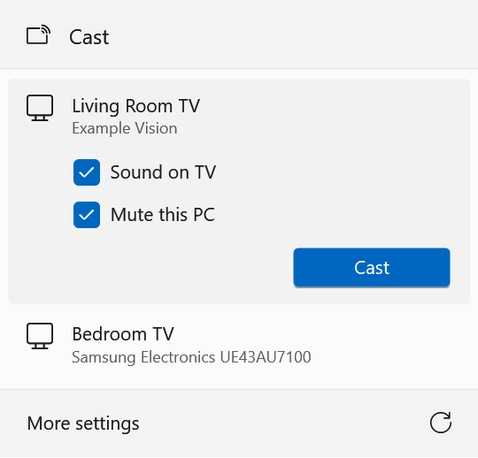
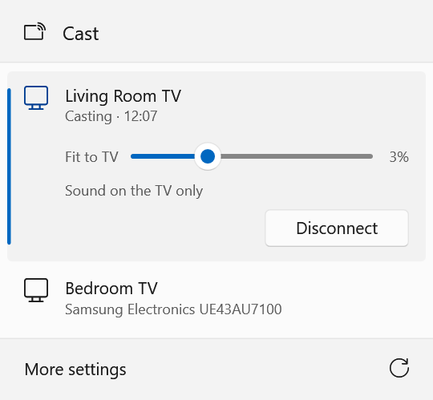

# TylerCast

**Show your computer's screen on your TV, with its sound, over your home Wi-Fi.**
No dongle, no box, no account: TylerCast sends the picture straight to a smart TV
that can play video over DLNA. It sits in the Mac's menu bar or the Windows system tray;
click your TV and it's on.

  
  &nbsp;
  

- **Your whole screen, live:** a video, slides, photos, a web page, at 1080p and 25
  frames a second.
- **Sound on the TV:** your computer's sound plays on the TV, and your computer's
  speakers go quiet while you cast (you can choose to keep both).
- **Fit to TV:** shrinks the picture if the TV cuts off its edges.
- **Private by design:** everything stays on your home network. Only the TV you chose can
  watch, there's no account, and nothing is sent anywhere else.

## Download

**[Get the latest release](../../releases/latest)**: free, for Windows and Mac.

### Windows 10 (version 2004 or later) or Windows 11

1. Download **`TylerCast-Setup-<version>.exe`** and open it. It installs for your user
   only, so no administrator password is needed.
2. TylerCast isn't code-signed yet, so Windows may say **"Windows protected your PC"**.
   Click **More info**, then **Run anyway**.
3. TylerCast appears in the system tray, next to the clock (look under **^** if you
   don't see it; you can drag it onto the taskbar to keep it in view).

To remove it: **Settings > Apps > Installed apps > TylerCast > Uninstall**.

### macOS 14 (Sonoma) or later, on Apple silicon (M1 or later)

1. Download **`TylerCast-mac-<version>.zip`**, open it, and drag **TylerCast.app** into
   **Applications**.
2. It isn't signed by Apple yet, so the first time, **right-click TylerCast.app and
   choose Open**, then click **Open**. If there's no Open button, try opening it once,
   then go to **System Settings > Privacy & Security** and click **Open Anyway**.
3. Allow **Screen & System Audio Recording** and **Local Network** when macOS asks
   (TylerCast needs them to see your screen and find your TV), then reopen TylerCast.

Each release lists the SHA-256 of its files, if you want to check a download.

## Casting

1. Turn the TV on (any normal input, not standby), on the same Wi-Fi as your computer.
2. Click the TylerCast icon (a small screen with a T). Your TV appears in the list within
   a few seconds.
3. Click the TV, then **Cast** (Windows), or click the TV's row (Mac). Your screen appears
   on the TV.
4. To stop, click **Disconnect** (Windows) or the TV's row again (Mac). Quitting
   TylerCast, or putting the computer to sleep, stops casting too.

The first time you cast on Windows, Windows asks whether TylerCast may use the network:
tick **Private networks** and click **Allow**. TylerCast waits for you.

## What you need

- **A TV that can play video sent over DLNA.** Many smart TVs can; in the TV's menus it
  may be called DLNA, *media renderer*, *DMR*, or *network remote*, and it may need
  switching on. TylerCast has been tried on one TV so far, so if yours doesn't work,
  please [open an issue](../../issues) with the TV's make and model.
- **The computer and the TV on the same home network.** Guest Wi-Fi networks usually
  keep devices apart, which stops it working.
- **About a second of delay** is normal: the TV buffers what it plays. Great for videos,
  photos and presentations; not for games.

## If something's not right

| What you see | What to try |
|---|---|
| The TV isn't listed | Make sure the TV is on (not standby) and on the same network, and that its DLNA or network-remote setting is on. Click the refresh button in the panel. On a Mac, check **System Settings > Privacy & Security > Local Network** allows TylerCast. |
| "Set to a public network" (Windows) | Windows blocks TVs from connecting on a public network. Click **Fix**, and set your Wi-Fi to **Private network**. |
| "The TV can't reach this computer" | Allow TylerCast in Windows' firewall question (or in **Windows Security > Firewall > Allow an app**); avoid guest networks. |
| The edges are cut off | Use **Fit to TV** (Windows) or **Margin** (Mac). |
| No sound on the TV | Check **Sound on TV** is on before you start casting. On a Mac, allow **Screen & System Audio Recording**. |
| The picture is jerky | Plug a laptop in: on battery, Windows and macOS slow it down. |
| Anything else | Open the log (**Settings > Open log** on Windows, **Show Log** on Mac) and [open an issue](../../issues) with what happened. Please remove anything private from the log first. |

## Privacy and security

TylerCast talks only to devices on your home network: it finds TVs, asks the one you
choose to play, and serves it the stream. Only that TV may connect, at a random web
address that changes every time you cast. It has no account, no analytics and no
automatic updates, and it keeps only a settings file and a log on your computer.

## For developers

TylerCast is two native apps with one design: Swift for the Mac (`Sources/`), C#/.NET
for Windows (`windows/`). Neither uses ffmpeg or other third-party media libraries:
each has its own MPEG-TS muxer and uses the system's screen capture and hardware video
encoder.

- [How the Mac app works, and building it](docs/mac.md)
- [The Windows app: building, testing, packaging](windows/README.md)
- [Keeping the Windows port in step with the Mac app](windows/PORTING.md)

Releases are built by GitHub Actions when a version tag is pushed (`v0.2.0`).

## Licence

MIT: see [LICENSE](LICENSE).
